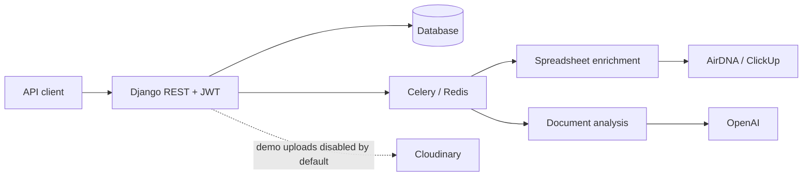

# Property research backend

A Django REST backend for a property-research workflow: manage client/customer accounts, organize leases and document revisions, store model-generated rental-regulation notes, and process rental-property spreadsheets through a Celery worker.

The code connects several services, but it is a prototype rather than a verified property, legal or investment decision system. Model responses are not checked against current regulations or independent sources. No browser, retrieval or citation-verification tool is connected to the regulation prompt.

## Request flow



Lease documents have revision numbers and analysis history. Rental rows carry a batch ID and an owning user ID. Ordinary accounts are restricted to their records; staff can administer records across owners. Customer management distinguishes staff from client accounts rather than trusting a user-supplied role label.

## Local setup

The requirements retain Django 5.1.2 and the existing provider SDK pins. Use an isolated Python environment; no blanket dependency migration was performed.

```sh
git clone https://github.com/dev-nezuko/property-stay-api.git
cd property-stay-api
python -m venv .venv
source .venv/bin/activate
python -m pip install -r requirements.txt
cp .env.example .env
python -c 'import secrets; print("SECRET_KEY=" + secrets.token_urlsafe(48))' >> .env
python manage.py migrate
python manage.py createsuperuser
python manage.py runserver
```

Development defaults to an ignored local SQLite database. Set `DATABASE_URL` to a private PostgreSQL connection string when testing PostgreSQL behavior; never copy a historical default password. Staging and production require their own database URL and host configuration. `.env` is read by the application and must stay untracked.

For queued work, start a local Redis instance and then:

```sh
celery -A bnbu_backend_api.celery:app worker --loglevel=INFO
```

Provider-backed actions require their own credentials and configuration. An account-only local run does not verify OpenAI, Cloudinary, AirDNA, ClickUp, Redis, email delivery or PostgreSQL. The existing `openai==0.28.0` calls use the older `ChatCompletion` interface; mixing in a new major SDK without adapting those calls will not work.

## API map

| Route | Purpose |
| --- | --- |
| `POST /api/token/` | Obtain JWTs with email and password |
| `POST /api/token/refresh/` | Refresh an access token |
| `/account/users/`, `/account/clients/` | Staff account administration |
| `/account/clients/{id}/customers/` | Client/customer relationships |
| `POST /account/users/update-password/{id}/` | Own-account first-login password update |
| `/api/leases/`, `/api/documents/` | Lease records, document metadata and custom actions |
| `/api/regulations/` | Saved model-generated location notes and chats |
| `/api/rental_properties/` | Rental rows, batch processing and filtered exports |

Authenticated API requests use `Authorization: Bearer <access-token>`. For example, `GET /api/leases/` returns the current account's paginated leases; staff see all leases. These are JSON APIs. The old README's registration, dashboard and profile HTML walkthrough did not describe the implemented application accurately; several account HTML views still lack templates.

## Important boundaries

- **Document uploads default off.** The legacy Cloudinary uploader makes files public. Do not enable `ENABLE_DOCUMENT_UPLOADS=1` for real leases or personal documents; that switch only permits synthetic demo files. Private storage, signed retrieval, upload validation and retention rules need a deliberate implementation first. Existing uploaded files are not made private by this code change.
- **Password reset is unavailable.** The old endpoint returned reset links to the caller and had no complete confirmation flow. It now returns a uniform 503 without account enumeration or a token. Add verified delivery and a confirmation endpoint before enabling it.
- **Task ownership has a time limit.** Rental task IDs are associated with their submitter in cache for 24 hours. Unassociated or expired tasks are staff-only. This is not a durable task-ownership ledger; database-backed ownership would be stronger.
- **No verified research guarantee.** Regulation prompts ask for current research, but the code only sends prompts to a model. Uploaded document content and addresses can reach configured providers. Use synthetic data during demonstrations.
- **Concurrency and recovery need more work.** Document version and batch ID allocation can race. Jobs lack a full durable recovery protocol, provider timeout coverage is uneven, and malformed provider responses need broader tests.

Redis TLS connections now require certificate verification. If credentials from earlier history were ever deployed, rotate them at their providers; rewriting Git cannot revoke credentials or remove external copies.

## Checks

```sh
python manage.py test accounts lease rental regulations --settings=bnbu_backend_api.test_settings
```

The isolated settings module uses in-memory SQLite, a local cache, local email and test-only password hashing. Never deploy with it. Twenty focused tests cover account creation, first-login restrictions, customer permissions, tenant-filtered lists/searches, document access, disabled uploads and task ownership.

The review ran those tests with Django 5.2 in an isolated environment, substituting a storage adapter that fails if called. It did not install the complete production dependency set or run live integrations. The repository's declared Django 5.1 environment remains to be verified. The existing CI workflow formats changed Python files against a hardcoded `origin/master` reference; it does not run this test suite. Improving it requires a token with workflow permissions.

`accounts/`, `lease/`, `regulations/` and `rental/` hold the domain code; `bnbu_constants/utility.py` contains spreadsheet and enrichment helpers. No license file is included.
