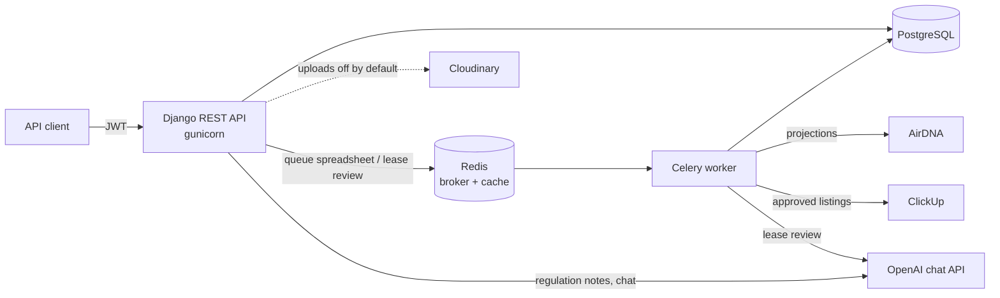

# Property Stay API

A Django REST backend for a short-term-rental research workflow. Staff manage client and customer accounts; clients keep leases with versioned lease documents, ask a language model to review a lease or summarise local short-term-rental rules, and upload spreadsheets of rental listings that a Celery worker enriches with AirDNA projections and scores for profitability.

It is a working prototype, not a verified property, legal or investment decision system. Model answers are not checked against current regulations or independent sources, and no browser, retrieval or citation tool is connected to the prompts.

## How it fits together



| App | Responsibility |
| --- | --- |
| `accounts` | Email-based custom user with roles (admin, research, coach, client, customer), staff administration of users and clients, client-owned customers, first-login password change |
| `lease` | Leases, versioned documents, queued model review of a lease PDF, per-document chat |
| `regulations` | Saved short-term-rental rule lookups for a place, model summary and follow-up chat |
| `rental` | Spreadsheet upload, AirDNA enrichment and profit scoring in Celery, filtered listing and CSV export |
| `bnbu_constants` | Spreadsheet parsing, AirDNA client and the profit/status rules |

The Django project package is `bnbu_backend_api`.

## Run it with Docker Compose

Needs Docker with Compose v2. This starts the API on port 8000, a Celery worker, PostgreSQL 17 and Redis 7:

```sh
cp .env.example .env
echo "SECRET_KEY=$(openssl rand -hex 32)" >> .env
echo "POSTGRES_PASSWORD=$(openssl rand -hex 16)" >> .env
docker compose up --build -d
docker compose exec web python manage.py createsuperuser
```

The web container applies migrations before gunicorn starts. The admin site is at <http://localhost:8000/admin/>, and the JSON API is under `/api/` and `/account/`. Stop with `docker compose down` (add `-v` to drop the database volume).

The provider keys in `.env` (OpenAI, AirDNA, ClickUp, Cloudinary) can stay empty: accounts, leases, searches, filters and exports work without them. Spreadsheet uploads are still queued and processed, but rows are only saved once `AIRDNA_URL` and `AIRDNA_API_KEY` are set.

## Run it without Docker

Python 3.12 (see `.python-version`). Development settings default to a local SQLite file, and Redis is only needed for the cache and Celery.

```sh
python -m venv .venv
source .venv/bin/activate
pip install -r requirements-dev.txt
cp .env.example .env
echo "SECRET_KEY=$(python -c 'import secrets; print(secrets.token_urlsafe(48))')" >> .env
python manage.py migrate
python manage.py createsuperuser
python manage.py runserver
```

Set `DATABASE_URL` in `.env` to use PostgreSQL instead. For queued work, start Redis and then run `celery -A bnbu_backend_api worker --pool=threads --loglevel=info`.

## Tests and lint

```sh
python manage.py test --settings=bnbu_backend_api.test_settings
flake8
```

or, inside the Compose image:

```sh
docker compose run --rm --no-deps web python manage.py test --settings=bnbu_backend_api.test_settings
```

`test_settings` uses in-memory SQLite, a local-memory cache, fast password hashing and no network; every provider call in the 65 tests is mocked. Never deploy with it. The tests cover per-owner isolation across leases, documents, regulations, rentals and customers; first-login rules; the upload opt-in; batch numbering; the rental filter and CSV export; the lease analysis pipeline and chat payloads; and the deployment settings.

## API

All endpoints except token creation need `Authorization: Bearer <access token>`.

| Route | Purpose |
| --- | --- |
| `POST /api/token/`, `POST /api/token/refresh/` | Obtain and refresh JWTs with `email` and `password` |
| `/account/users/`, `/account/users/{id}/` | Staff: list, create, update and delete users |
| `/account/clients/`, `/account/clients/{id}/` | Staff: client accounts (deleting a client deletes its customers) |
| `/account/clients/{id}/customers/`, `.../create/`, `.../{customer id}/` | Staff, or the client itself: its customers |
| `POST /account/users/update-password/{id}/` | Own account only, first login only: set a new password |
| `POST /account/password/change/` | Change your own password |
| `GET /account/profile/`, `GET /account/dashboard/` | Current user; role-specific dashboard message |
| `/api/leases/` (+ `upload/`, `search/`, `{id}/revised/`) | Leases and document uploads |
| `/api/documents/` (+ `review/`, `{id}/chat/`, `{id}/get-chat-history/`, `preview/{id}/`, `lease/{id}/documents/`) | Document metadata, queued review, chat |
| `/api/regulations/` (+ `search/`, `{id}/chat/`, `{id}/get-chat-history/`) | Rule lookups; creating one asks the model immediately |
| `/api/rental_properties/` (+ `upload-properties/`, `task-progress/`, `task-result/`, `filtered-list/`, `download-csv/`, `all-properties/`) | Listings, spreadsheet import and exports |

Ordinary accounts only ever see their own leases, documents, regulations and rental rows; staff see everything. Lease and regulation searches take `YYYY-MM-DD` dates; the rental filters take dates written like `December 3, 2024`. Both treat the end date as inclusive.

### Examples

These were captured from the Compose stack with the demo data shown. Tokens and the long listing record are shortened.

Log in:

```sh
curl -s -X POST localhost:8000/api/token/ -H 'Content-Type: application/json' \
  -d '{"email": "admin@example.test", "password": "<your password>"}'
```

```json
{"refresh": "eyJhbGciOiJIUzI1NiIs...", "access": "eyJhbGciOiJIUzI1NiIs..."}
```

Create a client, then a customer for it (staff token):

```sh
curl -s -X POST localhost:8000/account/clients/ -H "Authorization: Bearer $TOKEN" \
  -H 'Content-Type: application/json' \
  -d '{"email": "client@example.test", "first_name": "Casey", "last_name": "Client", "user_type": "client"}'
```

```json
{"id": 2, "email": "client@example.test", "first_name": "Casey", "last_name": "Client", "user_type": "client", "is_active": true, "is_first_login": true}
```

```sh
curl -s -X POST localhost:8000/account/clients/2/customers/create/ -H "Authorization: Bearer $TOKEN" \
  -H 'Content-Type: application/json' \
  -d '{"email": "tenant@example.test", "first_name": "Taylor", "last_name": "Tenant"}'
```

```json
{"id": 3, "email": "tenant@example.test", "first_name": "Taylor", "last_name": "Tenant", "user_type": "customer", "is_active": true, "is_first_login": true, "client": 2}
```

New accounts get a random temporary password and `is_first_login: true`; there is no email delivery, so an admin shares or resets the password out of band.

Create a lease without documents, then search for it:

```sh
curl -s -X POST localhost:8000/api/leases/upload/ -H "Authorization: Bearer $TOKEN" \
  -H 'Content-Type: application/json' \
  -d '{"address1": "101 Harbor View Rd", "city": "Sampletown", "state": "FL", "zip_code": "33000"}'
curl -s "localhost:8000/api/leases/search/?address=Harbor" -H "Authorization: Bearer $TOKEN"
```

```json
{"count": 1, "next": null, "previous": null, "results": [{"id": 1, "date": "2026-11-09", "address1": "101 Harbor View Rd", "address2": null, "city": "Sampletown", "state": "FL", "zip_code": "33000", "status": "Draft", "num_of_docs": 0, "documents": []}]}
```

Upload a listing spreadsheet (`docs/sample-listings.csv` has the expected columns) and poll the task:

```sh
curl -s -X POST localhost:8000/api/rental_properties/upload-properties/ \
  -H "Authorization: Bearer $TOKEN" -F file=@docs/sample-listings.csv
curl -s "localhost:8000/api/rental_properties/task-progress/?task_id=<task_id>" -H "Authorization: Bearer $TOKEN"
```

```json
{"success": true, "message": "Batch 1 processing started", "task_id": "0db1bbbc-88ac-4b04-a6dc-b2f39ed04758"}
{"success": true, "state": "SUCCESS", "progress": 100, "result": "[]"}
```

The empty result is what the stack returns without AirDNA credentials: the worker logs `AIRDNA_URL is not configured` and saves no rows.

Filter listings and export them:

```sh
curl -s -X POST localhost:8000/api/rental_properties/filtered-list/ -H "Authorization: Bearer $TOKEN" \
  -H 'Content-Type: application/json' -d '{"status": "Approved", "min_profit": 1000}'
curl -s "localhost:8000/api/rental_properties/download-csv/?status=Approved" -H "Authorization: Bearer $TOKEN"
```

```json
{"count": 1, "next": null, "previous": null, "results": {"all_batch_ids": [1], "properties": [{"id": 1, "created_at_formatted": "November 09, 2026", "user_id": 1, "location": "22 Orchard Ln, Sampletown, FL 33000", "rent": 1850, "no_of_bedrooms": 1, "no_of_bathrooms": 1, "square_feet": 780, "property_zillow_link": "https://listings.example.com/22-orchard", "property_status": "Approved", "monthly_estimated_profit": "1120.50", "batch_id": 1, "...": "..."}]}}
```

```text
Date,Batch Id,Location,Rent,Bedrooms,Bathrooms,Square Feet,Link,Adr,Utilities,Estimated Profit,Estimated Earnings,Yearly Rent Cost,Occupancy Rate,Zillow Property Status
"November 09, 2026",1,"22 Orchard Ln, Sampletown, FL 33000",1850,1,1,780,https://listings.example.com/22-orchard,,,1120.50,,,,Approved
```

Invalid input is a 400 with the field name, and a missing token is a 401:

```json
{"start_date": "Use \"Month day, year\" (e.g., December 3, 2024)."}
{"detail": "Authentication credentials were not provided."}
```

## How listings are scored

For each uploaded row the worker asks AirDNA for projected annual revenue, then computes

- utilities = bedrooms x 2,000 per year,
- yearly cost = monthly rent x 12 + utilities,
- monthly profit = (projected revenue - yearly cost) / 12,

and marks the listing Approved when the monthly profit reaches 1,000 (one bedroom), 1,500 (two) or 2,000 (three or more), otherwise Rejected. Approved listings are pushed to a ClickUp list when ClickUp is configured. Rows without square footage are skipped.

## Configuration

Settings come from environment variables (or `.env`, which must stay untracked). `.env.example` lists every key.

| Variable | Used for |
| --- | --- |
| `SECRET_KEY` | Required. Django signing key |
| `ENVIRONMENT` | `development` (default), `staging` or `production`. Staging and production require `DATABASE_URL`, trust `X-Forwarded-Proto`, redirect to HTTPS and use secure cookies |
| `DEBUG`, `ALLOWED_HOSTS`, `CORS_ALLOWED_ORIGINS` | Usual Django settings; CORS origins are a JSON list |
| `DATABASE_URL` | PostgreSQL URL; development falls back to `development.sqlite3` |
| `REDIS_URL` | Cache, Celery broker and result backend. `rediss://` URLs verify certificates |
| `SECURE_SSL_REDIRECT`, `SECURE_HSTS_SECONDS` | HTTPS redirect (on by default when deployed) and opt-in HSTS |
| `OPENAI_API_KEY` | Lease review, regulation notes and both chats (0.x `openai` client, `gpt-4`) |
| `AIRDNA_URL`, `AIRDNA_API_KEY` | Listing enrichment |
| `CLICKUP_URL`, `LIST_ID`, `TEAM_ID`, `ACCESS_TOKEN`, `APPROVED`, `ZILLOW_CUSTOM_ID`, `PROPERTY_STATUS_CUSTOM_ID` | ClickUp task creation for approved listings |
| `ENABLE_DOCUMENT_UPLOADS`, `CLOUDINARY_*` | Lease document uploads; see below |

The `Procfile` (release/web/worker) targets Heroku-style platforms.

## Design notes and boundaries

- **Ownership is enforced in querysets.** The lease, document, regulation and rental viewsets filter by owner for non-staff users, so another owner's record is a 404; customer routes answer 403 to other clients. Server-written fields (model output, chat history, document files and versions) are read-only through the API, and chat endpoints act on the object in the URL.
- **Document uploads are off by default.** The Cloudinary uploader stores files publicly. `ENABLE_DOCUMENT_UPLOADS=1` is meant for synthetic demo files only; private storage, signed URLs, validation and retention rules would be needed for real leases.
- **First login.** Accounts created by staff or clients must set a password through `update-password/{id}/` before that flag clears; profile edits do not clear it.
- **Password reset is disabled.** The endpoint returns a uniform 503 without revealing whether an account exists, because there is no verified delivery or confirmation flow yet.
- **Task ownership is cached.** A rental upload's task ID is tied to its submitter in Redis for 24 hours; unknown or expired task IDs are staff-only. Batch numbers come from an atomic Redis counter seeded from the database. A database table would make both durable.
- **Model output is unverified.** The status of a lease or regulation is read from the model's text. Uploaded document text and addresses are sent to the configured providers, so demonstrate with synthetic data.

If provider credentials from earlier versions of this code were ever deployed, rotate them at the providers.

## License

MIT, see [LICENSE](LICENSE).
